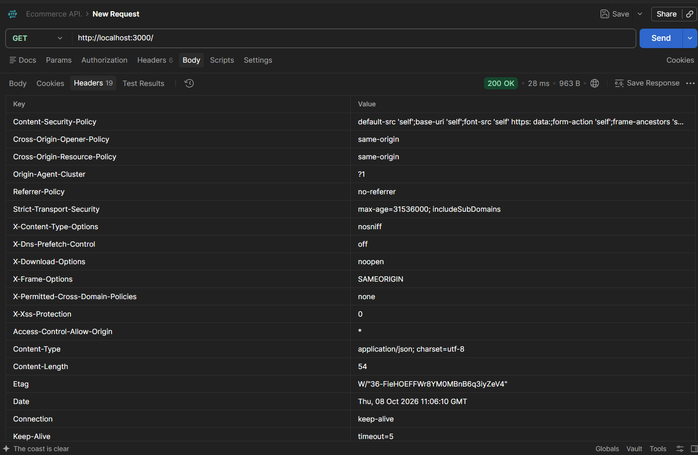

1. Plain-Text Password (User Registration) :
تخزين كلمات المرور بصيغة نصية واضحة مما يؤدي الى كشف حسابات المستخدمين باكامل عند حدوث تسريب في قاعدة البيانات 
طريقة المعالجة : استخدام مكتبة bcyrpt لتوليد hash لكلمات المرور قبل تخزينها ومقارنتها باستخدام bcrypt.compare عند تسجيل الدخول 

2. SQL Injection : في ملفات ال controllers واستعلامات البحث والفلترة مما يؤدي الى دمج مدخلات المستخدم مباشرة داخل SQL string concervation 
- طريقى المعالجة : استخدام (Parameterized Queries) مثل (`$1, $2`) مع حزمة placeholders

3. Missing Authentication & Authorization :
- الخطر : امكانية قيام اي customer او شخص مجهول بتنفيذ عمليات اضافية ادارية حساسة مثل اضافة او حذف المنتجات 
- طريقة المعالجة : بناء Auth Middleware يعتمد على رموز 'JWT' و Authorize Middleware للتحقق من الادوار

4. Detailed Stack Trance : 
- الخطر : اظهار اخطاء قاعدة البيانات التفصيلية او مسارات الملفات للمستخدم مما يساعد المهاجم في دراسة بنية النظام الداخلية 
- طريقة المعالجة : انشاء وسيط مركزي لمعالجة الاخطاء يعيد رسائل عامة وامنة للمستخدم مثل Internal server error 

5. Missing security header & rate limiting :
- الخطر : تعرض ال API لهجمات Brute Force وهجمات XSS 
- طريقة المعالجة : تفعيل Helmet payload لضبط ترويسات الامان وتفعيل express- rate- limit للحد من محاولات تسجيل الدخول المتكررة 

___________________________

توثيق ثلاثة Headers وفوائدها :
1. X-Content-Type-Options: nosniff
الفوائد: يمنع المتصفح من تخمين نوع الملف (MIME-sniffing)، ويجبره على الالتزام بالنوع المحدد في الـ Header، مما يحمي من رفع ملفات خبيثة وتنفيذها ككود برمجي.

2. X-Frame-Options: SAMEORIGIN
الفوائد: يحمي التطبيق من هجمات الـ Clickjacking عن طريق منع عرض موقعك داخل iframe في مواقع خارجية، ويسمح بعرضه فقط داخل نفس النطاق.

3. Strict-Transport-Security (HSTS) :
الفوائد: يجبر المتصفحات على التواصل مع السيرفر حصرياً عبر بروتوكول الحماية المشفر HTTPS بدلاً من HTTP العادي، مما يمنع اعتراض البيانات.

